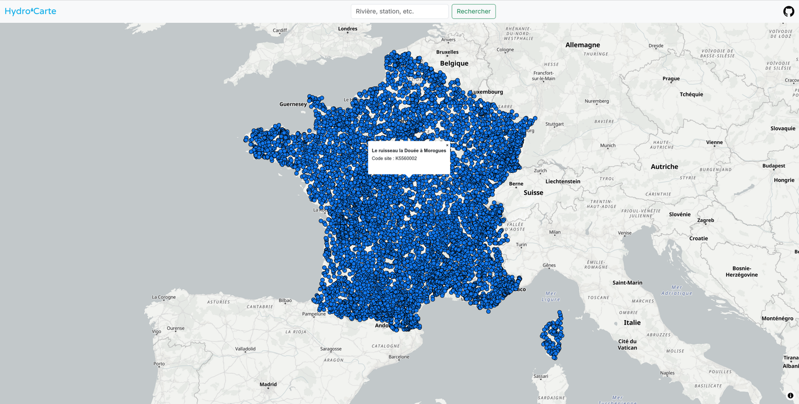

# Hydro'Carte

Hydro’Carte est une application web open source de cartographie hydrologique française. Elle a deux objectifs :

- Permettre de consulter facilement les données publiques sur les cours d'eau
- Avoir une dimension pédagogique, autour de la sécheresse, de la biodiversité et la qualité de l'eau

## État actuel du projet



*Page principale du site, sujette au changement*

Le projet n'est qu'à l'état de prototype, et plusieurs contraintes techniques restent à résoudre (différenciation des sites par dates, BDD PostGIS dans le futur). Cependant, il a vocation à devenir un projet bien plus sérieux, et il doit aussi servir à m'apprendre les bases du développement SIG et toute la chaîne autour (récupération des données, nettoyage, BDD, API, back-end, front-end et autres).

## Déploiement
Le projet sera disponible sur le site [hydrocarte.fr](https://hydrocarte.fr)

Sinon, il est possible de l'héberger soi-même. Le projet à besoin de `npm` et de `python` (avec la bibliothèque `requests`). Pour télécharger et lancer le projet :
```bash
git clone https://github.com/Misheru504/HydroCarte.git
cd HydroCarte
npm install
npm run dev # Version développement
npm run build # Build de déploiement
```

Le site utilise des scripts python pour créer ses référentiels (notamment pour les sites hydrométriques). Ceci sont dans le dossier `/scripts` du projet et sont exécutés automatiquement lors des commandes `dev` et `build`. Il est possible d'utiliser `npm run create-date` pour les créer manuellement.
